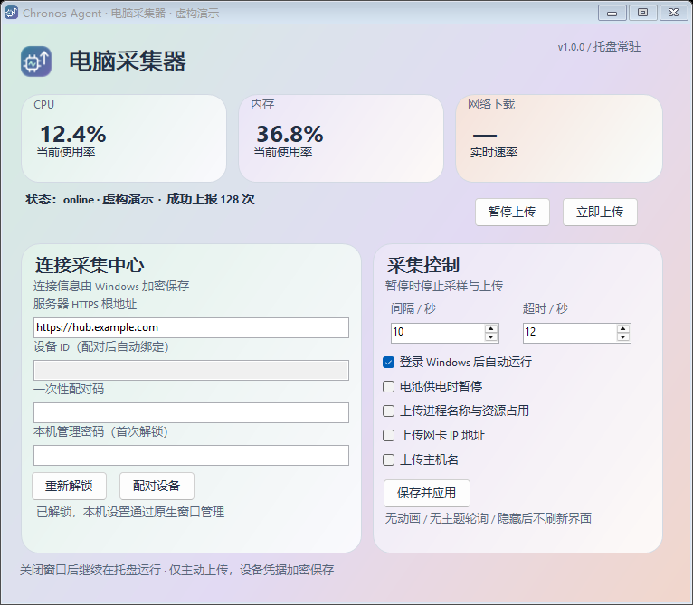
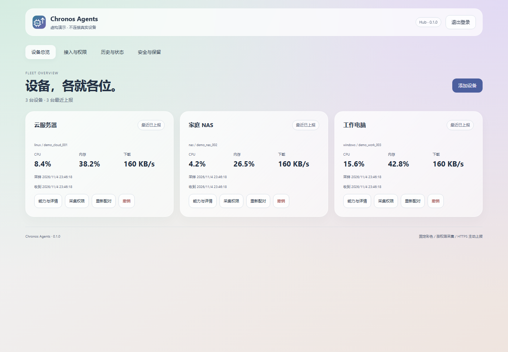
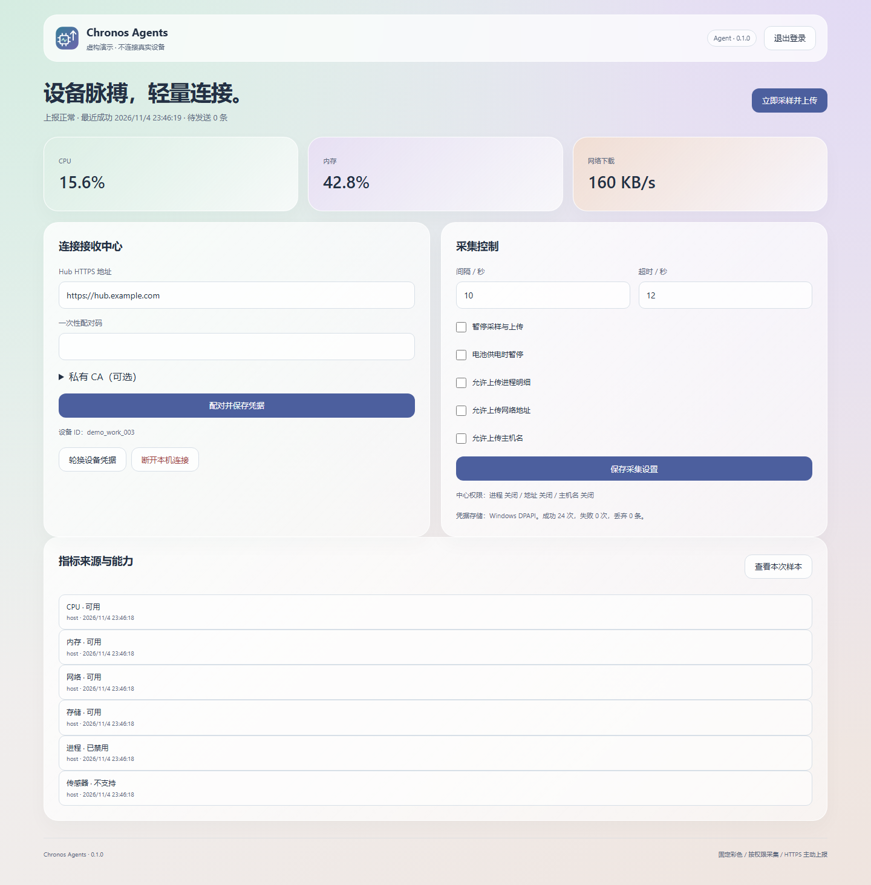
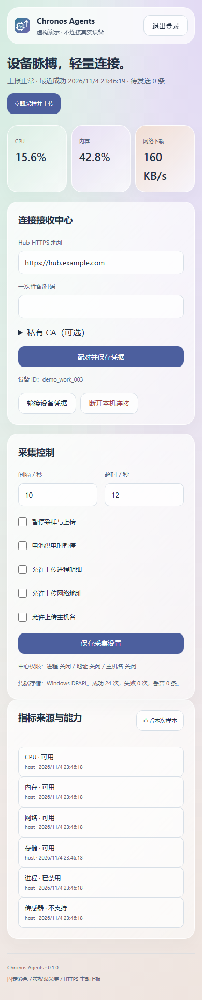
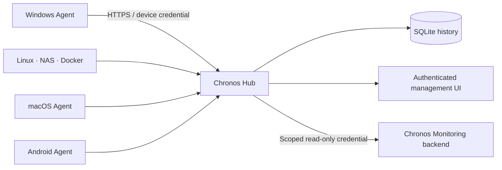

<p align="center"></p>
<h1 align="center">Chronos Agents</h1>
<p align="center">多端采集，一个接收中心。数据留在你自己的服务器。</p>

<p align="center">
  <a href="https://github.com/Jimmy-xuzimo/Chronos-Agents/actions/workflows/verify.yml"></a>
  <a href="LICENSE"></a>
  
</p>

Chronos Agents 是独立的设备遥测项目，包含轻量采集器、Android 应用、带管理网页的 Hub，以及 Chronos Monitoring 的只读适配层。Windows、Linux、macOS 共用 Go 采集核心；Android 使用原生 Compose 与 WorkManager，并遵循相同的协议、单位和能力状态。

**首个正式版本 1.0.0。** 建议先接入一台测试节点。可用功能、构建结果和未完成的实机验证分别记录在 [验证记录](docs/VALIDATION.md)，不将交叉编译等同于实机通过。

[产品主页](https://jimmy-xuzimo.github.io/Chronos-Agents/) · [正式版下载](https://github.com/Jimmy-xuzimo/Chronos-Agents/releases/latest)

## 各端交互

- **Windows：**从开始菜单或托盘打开原生窗口；关闭窗口继续采集。管理密码可以由 DPAPI 加密记住，设备 Token 保持原有存储。
- **macOS：**SwiftUI 原生窗口 + 菜单栏后台程序。管理密码保存在钥匙串；安装脚本支持登录自启动。
- **Linux / NAS：**保留认证网页端口，支持原生服务和 Docker。
- **Android：**原生 Compose App。

桌面程序内部仍使用仅绑定 loopback 的本机 API，让界面与采集核心解耦；日常操作不需要浏览器，未引入 WebView 或 Electron。Hub 的管理网页独立保留。

## 界面预览

Windows 沿用配套电脑采集器的原生双栏界面。下图由正式窗口代码渲染，使用虚构数据。



下图为真实管理页渲染，使用虚构设备数据，不连接私人服务器。



<details><summary>查看采集器管理页和手机布局</summary>





</details>

## 可以做什么

| 部分 | 功能 |
|---|---|
| 桌面采集器 | Windows / macOS 原生窗口、托盘 / 菜单栏、暂停、采样间隔和隐私控制；Linux / NAS 网页管理 |
| Linux / NAS | 原生后台服务或 Docker；有独立管理端口、登录和 CSRF 防护 |
| Android | 手动或二维码图片配对、后台周期上报、应用可见时实时采集、网络与供电约束 |
| Hub | 设备列表、一次性配对、采集权限、只读连接、撤销、历史、审计、保留期限、密码与 TOTP |
| 工作台适配 | 将稳定 Hub 设备 ID 映射至已有节点；保持原登录和未迁移节点；不重复保存历史 |

CPU、内存、Swap、磁盘容量、逐设备磁盘读写、网卡吞吐、系统信息、可选进程和电池均有明确状态。**不支持、权限不足、预热、关闭和采集失败分别表达，不用 0 假装正常。** Android 不宣称能够读取完整整机 CPU、其他应用进程或桌面级系统信息。NAS 宿主采集使用明确的只读挂载；纯容器模式尚不提供 cgroup 资源指标。详见 [指标口径](docs/METRICS.md)。



## 开始使用

1. **部署 Hub。** 配置自己的 HTTPS 根地址及证书。首次初始化凭据在私有数据目录的 `bootstrap-secret`，不会写日志；用它设置至少 12 位管理密码，随后凭据失效。
2. **添加设备。** 管理页选择设备类型，生成十分钟内有效、只能使用一次的配对码。
3. **启动对应 Agent。** 首次同样初始化本地管理密码，再填入 Hub 地址和配对码。设备凭据保存在系统凭据保护设施或受限文件中。
4. **确认能力与来源。** 首个 CPU / 吞吐样本需要建立基线。进程、主机名和网络地址必须本地与 Hub 同时允许才会上报。
5. **按需连接工作台。** 创建限定设备范围的只读凭据，仅放在工作台后端。迁移一台测试节点后再切换正式节点。

下载位置：[Releases](https://github.com/Jimmy-xuzimo/Chronos-Agents/releases)。安装与证书说明见 [部署指南](docs/DEPLOYMENT.md)；适配方法见 [工作台接入](adapters/chronos-monitoring/README.md)。不要用旧工作台登录密码或旧上报 Token 代替本项目配对码。

### 本地开发

需要 Go 1.27、Python 3；Android 另需 JDK 21+、Android SDK 37 与 Gradle Wrapper。仓库不依赖外部前端 CDN，也不需要 Node 构建管理页。

```sh
python scripts/generate_protocol.py --check
go test ./...
go build -o artifacts/chronos-hub ./cmd/hub
go build -o artifacts/chronos-agent ./cmd/agent
```

在两个终端分别运行，使用不同的私有配置目录：

```sh
artifacts/chronos-hub --data .runtime/hub --listen 127.0.0.1:17870 --origin http://127.0.0.1:17870 --dev-loopback-http
artifacts/chronos-agent --data .runtime/agent --dev-loopback-http
```

开发用 HTTP 例外只接受显式开启的 loopback 地址，远程生产连接仍要求 HTTPS。Windows 使用 `.exe` 后缀。无桌面服务器构建时添加 `-tags headless` 并运行 `--headless`；macOS 托盘需本机 CGO 构建并附带 Keychain helper。

Android：

```sh
cd clients/android
./gradlew :app:assembleDebug :app:lintDebug
```

Debug APK 用于开发验证，正式分发使用自己的私有签名配置。仓库不包含签名私钥。构建网络受限时，可显式设置 `CHRONOS_MAVEN_MIRROR`，仅为 ZXing 分组增加镜像；默认仍使用官方仓库，依赖校验保持开启。

## 数据与安全边界

- 设备 Token 只写自己的节点；只读 Token 只能读取授权节点；管理操作使用独立 Cookie、CSRF 和可选 TOTP。
- 一次性配对码十分钟过期；Token 以哈希保存于 Hub；轮换保留十分钟旧凭据宽限，撤销立即使新旧凭据均失效。
- Windows DPAPI、macOS Keychain、Android Keystore；Linux 桌面优先 Secret Service，无密钥环时为服务用户的 0600 文件。Linux 文件保护不能替代磁盘加密。
- 原始基础样本默认 24 小时，分钟汇总 30 天，审计 90 天。进程明细只保留当前快照，不写入历史。
- 客户端业务样本只在内存中缓存；Go 离线队列最多 60 条 / 1 MiB，停止或重启后丢弃。失败有退避，不承诺断网期间持续高频采样。
- 不采集短信、联系人、浏览器历史、剪贴板、硬件序列号、文件正文或定位。不上报凭据，不提供远程执行命令或脚本。
- HTTPS 认证不能证明被攻陷设备上报的读数一定真实。多租户隔离、大规模集群和硬件可信证明不属于本版承诺。

更多内容：[安全设计](docs/SECURITY.md) · [隐私说明](docs/PRIVACY.md) · [协议](protocol/schema.json) · [OpenAPI](protocol/openapi.json)。

## 目录

```text
cmd/{agent,hub}                Go 应用入口
internal/{collector,agent,hub} 采集、调度与接收
internal/{security,secret}     认证和平台凭据保护
clients/android               原生 Android 客户端
web/ui                        内嵌的 Hub / Agent 管理页
protocol                      跨端协议与接口说明
deploy                        Docker、systemd、Windows、macOS
adapters/chronos-monitoring    工作台后端只读适配
docs                          部署、指标、安全和验证记录
```

## 贡献与许可

问题报告请写明平台、版本、部署方式及**脱敏后的**错误码。不要附带 Token、Cookie、配对二维码、私有 CA 密钥或配置目录。安全问题请参考 [SECURITY.md](SECURITY.md)，不要公开提交有效凭据。

项目代码使用 [Apache License 2.0](LICENSE)。第三方依赖保留各自许可，见 [THIRD_PARTY_NOTICES.md](THIRD_PARTY_NOTICES.md)。Windows 商业代码签名和 macOS 签名／公证需要发行者自己的证书，未签名构建会明确标注。
