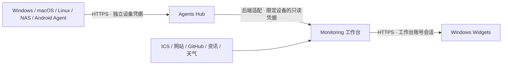

# Chronos 系列：选择、连接与迁移

三个独立的开源项目，沿用统一的马卡龙渐变、悬浮玻璃、矢量图形与明暗设计。它们分别部署、按需组合，不要求全部安装。

| 项目 | 负责什么 | 产品网页 | 源码 | 开始使用 |
| --- | --- | --- | --- | --- |
| **Monitoring** | 自托管个人工作台；课表、设备、网站证书、入口、GitHub 与资讯 | [介绍与演示](https://jimmy-xuzimo.github.io/Chronos-Monitoring/) | [仓库](https://github.com/Jimmy-xuzimo/Chronos-Monitoring) | [部署指南](https://github.com/Jimmy-xuzimo/Chronos-Monitoring/blob/main/docs/deployment.md) |
| **Widgets** | Windows 桌面展示端；读取工作台信息，自由排布组件 | [产品介绍](https://jimmy-xuzimo.github.io/Chronos-Widgets/) | [仓库](https://github.com/Jimmy-xuzimo/Chronos-Widgets) | [安装与连接](https://github.com/Jimmy-xuzimo/Chronos-Widgets/blob/main/docs/GETTING_STARTED.md) |
| **Agents** | 跨平台设备采集与独立 Hub；认证上报、权限与历史 | [产品介绍](https://jimmy-xuzimo.github.io/Chronos-Agents/) | [仓库](https://github.com/Jimmy-xuzimo/Chronos-Agents) | [部署与配对](https://github.com/Jimmy-xuzimo/Chronos-Agents/blob/main/docs/DEPLOYMENT.md) |

## 哪些需要安装

- 只需要个人面板：部署 **Monitoring** 即可，云服务器本机指标、课程、资讯等由其后端维护。
- 需要多设备统一采集：部署 **Agents Hub**，在 Windows / macOS 安装原生采集器、Linux / NAS 运行服务或 Docker，Android 使用采集 App。各端的可读指标受平台权限限制，不支持的指标明确标记。
- 想在 Windows 桌面查看：安装 **Widgets**，使用自己的 HTTPS Monitoring 地址和工作台账号登录。Widgets 不直接连接 Agents Hub，不承担采集任务。
- 只需要设备遥测：**Agents** 可独立使用，不依赖 Monitoring 或 Widgets。

## 数据如何流动

Hub 不承载课表、资讯和网站探测；这些由工作台提供。服务器本机监控也可以继续使用 Monitoring 原有采集进程。

接入 Monitoring 需要按 [适配器说明](https://github.com/Jimmy-xuzimo/Chronos-Agents/blob/main/adapters/chronos-monitoring/README.md) 安装并配置后端适配层。将只读凭据保存在服务器，显式映射 Hub 设备 ID；不要把它写入网页、Widgets 或公开仓库。保留工作台原节点 ID，才能延续现有入口及历史查询。

## 账号和凭据不混用

| 用途 | 使用什么 | 不应填什么 |
| --- | --- | --- |
| Widgets 登录 | Monitoring 网页账号、密码 | Hub 管理密码、设备配对码 |
| 新 Agent 连接 Hub | Hub HTTPS 地址、短时一次性配对码 | 旧采集器 Token、工作台网页密码 |
| Agent 本地解锁 | 本机 / 本容器的管理密码 | Hub 只读凭据 |
| 工作台读取 Hub | 限定设备范围的只读凭据 | 设备上报凭据、Hub 管理密码 |

桌面采集器日常操作使用原生窗口。Linux / NAS 使用认证管理网页；该管理端口与向 Hub 上传数据的地址是两回事。浏览器通过私有自签证书访问管理页时，应先核对证书，而不是关闭生产上报证书校验。

## 从旧采集器迁移

Monitoring 仓库中的 Windows 1.2.0 和 Python NAS / Linux 采样器保留用于旧接口兼容。新部署的跨平台采集优先评估独立 Agents 项目；它使用独立协议，**不是覆盖旧程序后就自动兼容**。

1. 备份原配置和部署定义，先在 Hub 配对一台测试设备。
2. 确认 CPU、内存、磁盘、网络的能力状态及连续上传；不要把容器指标误认为宿主指标。
3. 安装只读适配层并映射既有节点，确认历史切换边界与原始设备顺序。
4. 验证新数据后，停止旧设备采集器和它的自启动，避免双重上报；保留回退文件。
5. Widgets 仍然连接原工作台；无需填写 Hub Token。设备绑定保留时，不必重建所有桌面组件。

## 发布、演示与隐私

- 下载以各仓库 **公开 Releases** 为准；源码中的目标版本不代表该版本安装包已经公开。草稿和进行中的 CI 不算完成发行。
- 三个 Pages 都是静态产品介绍。Monitoring 的交互演示使用虚构内容；Widgets 和 Agents 的截图也使用虚构演示数据。
- Pages 不连接私人服务器，不读取生产账号、设备或课程，也不会替已安装程序更改外观和配置。
- Windows / macOS / Android 的实机范围，以各项目验证文档为准；不能用构建成功代替硬件实测。

[Monitoring 验证记录](https://github.com/Jimmy-xuzimo/Chronos-Monitoring/blob/main/docs/VALIDATION.md) · [Widgets 验证记录](https://github.com/Jimmy-xuzimo/Chronos-Widgets/blob/main/docs/VALIDATION.md) · [Agents 验证记录](https://github.com/Jimmy-xuzimo/Chronos-Agents/blob/main/docs/VALIDATION.md)
